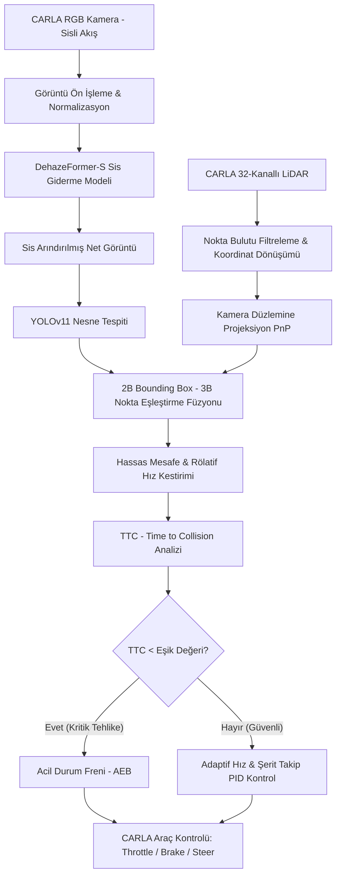

# 🚗 Adaptive Autonomous Driving in Adverse Weather Conditions
### 🌧️ CARLA Simulator • DehazeFormer-S • YOLOv11 • LiDAR-Kamera Füzyonu • TTC & PID Kontrolcü

<p align="center">
  <a href="#proje-özeti"></a>
  <a href="#algoritma-mimarisi"></a>
  <a href="#algoritma-mimarisi"></a>
  <a href="#sensör-füzyonu"></a>
  <a href="#araç-kontrolü"></a>
  <a href="#lisans"></a>
</p>

<p align="center">
  <strong>Zorlu ve sisli hava koşullarında derin öğrenme tabanlı görüntü iyileştirme (DehazeFormer), nesne tespiti (YOLOv11), LiDAR derinlik füzyonu ve güvenli otonom araç seyir kontrolü (TTC & PID) gerçekleştiren uçtan uca otonom sürüş mimarisi.</strong>
</p>

---

## 📑 İçindekiler
- [Proje Özeti & Motivasyon](#-proje-özeti--motivasyon)
- [Sistem Mimarisi](#-sistem-mimarisi)
- [Temel Bileşenler](#-temel-bileşenler)
  - [1. Görüntü İyileştirme (DehazeFormer-S)](#1-görüntü-iyileştirme-dehazeformer-s)
  - [2. Nesne Tespiti (YOLOv11)](#2-nesne-tespiti-yolov11)
  - [3. LiDAR-Kamera Sensör Füzyonu & Mesafe Analizi](#3-lidar-kamera-sensör-füzyonu--mesafe-analizi)
  - [4. Çarpışma Riski Kestirimi (TTC) & PID Kontrol](#4-çarpışma-riski-kestirimi-ttc--pid-kontrol)
- [Deneysel Sonuçlar & Karşılaştırmalı Performans](#-deneysel-sonuçlar--karşılaştırmalı-performans)
- [Görselleştirmeler & HUD](#-görselleştirmeler--hud)
- [Dizin Yapısı](#-dizin-yapısı)
- [Kurulum & Kullanım](#-kurulum--kullanım)
- [Akademik Arka Plan & Tezin Tam Metni](#-akademik-arka-plan--tezin-tam-metni)
- [Geliştiriciler & Katkıda Bulunanlar](#-geliştiriciler--katkıda-bulunanlar)
- [Lisans](#-lisans)

---

## 🎯 Proje Özeti & Motivasyon

Otonom sürüş sistemlerinin en kritik güvenlik açığı, **yoğun sis, pus ve olumsuz hava koşullarında** kamera sensörlerinin kontrast ve ayrıntı kaybına uğramasıdır. Klasik nesne tespit modelleri, yoğun sis altında araç ve yaya algılamasında **%60'a varan doğruluk (mAP) kaybı** yaşamakta; bu da otonom araçların reaksiyon süresini tehlikeye atmaktadır.

Bu projede:
1. **Fotogerçekçi CARLA Simülatörü** üzerinde dinamik sis, yağmur ve ışık koşullarında otonom araç test ortamı kurulmuştur.
2. Sisli kamera akışı gerçek zamanlı olarak **DehazeFormer-S** (Vision Transformer tabanlı derin model) ağına beslenerek sis ve pus katmanları temizlenir.
3. İyileştirilmiş görüntü üzerinden son teknoloji **YOLOv11** mimarisi ile araçlar, yayalar, bisikletliler ve trafik işaretleri tespit edilir.
4. Tespit edilen nesneler **LiDAR nokta bulutları (Point Cloud)** ile uzamsal olarak eşleştirilerek (Camera-LiDAR Calibration & Projection) gerçek 3B öklid mesafeleri çıkarılır.
5. **Çarpışma Süresi (TTC - Time-to-Collision)** metriği ve **PID boylamsal/yanal kontrolcüleri** ile araç şeritte kalır, hızını öndeki engellere göre dinamik ayarlar ve kritik mesafelerde acil fren (AEB) uygular.

```
[ Sisli CARLA Kamerası ] ---> [ DehazeFormer-S ] ---> [ YOLOv11 Tespiti ]
                                                            │
                                  [ LiDAR Nokta Bulutu ] ───┴──> [ 3B Füzyon & Mesafe ]
                                                                          │
                                                                          ▼
[ Araç Aktüatörleri: Gaz / Fren / Direksiyon ] <─── [ TTC & PID Kontrolcü ]
```

---

## 🏗️ Sistem Mimarisi

Aşağıdaki şemada sistemin CARLA sensör veri akışından başlayıp aktüatör kontrolüne kadar olan tam döngüsü gösterilmektedir:



---

## 🧩 Temel Bileşenler

### 1. Görüntü İyileştirme (DehazeFormer-S)
* **Model Tipi:** Swin Transformer tabanlı pencere dikkat mekanizmalı (W-MSA) ve kanal dikkatli derin sis arındırma ağı.
* **Optimizasyon:** Görüntü çözünürlüğü ve gecikme dengesi için `DehazeFormer-S` varyantı tercih edilmiştir.
* **Fonksiyon:** Atmosferik ışık saçılımı formülüne dayalı fiziksel modeli derin öğrenme ağırlıklarıyla tersine çevirerek kontrast ve renk canlılığını geri kazandırır.

### 2. Nesne Tespiti (YOLOv11)
* **Model:** Ultralytics YOLOv11 (YOLOv11x / YOLOv11m ağırlıklarıyla transfer learning).
* **Eğitilen Sınıflar (7 Sınıf):** `Vehicle` (Araç), `Person` (Yaya), `Signal` (Trafik Işığı), `Speedbump` (Hız Tümseği), `Pothole` (Çukur), `Obstacle` (Yol Engeli), `Animal` (Hayvan).
* **Farkı:** Sisli ham görüntü yerine DehazeFormer çıkışından beslendiğinde tespitteki yanlış negatif (kaçırılan araç/yaya) oranı dramatik şekilde düşmektedir.

### 3. LiDAR-Kamera Sensör Füzyonu & Mesafe Analizi
* LiDAR'dan gelen milyonlarca $(X, Y, Z)$ koordinatı, kameranın içsel ($K$) ve dışsal ($[R | T]$) kalibrasyon matrisleri kullanılarak kamera 2B koordinat düzlemine $(u, v)$ izdüşürülür:

$$\begin{bmatrix} u \\ v \\ 1 \end{bmatrix} = \frac{1}{Z_c} K \cdot [R \mid T] \cdot \begin{bmatrix} X_l \\ Y_l \\ Z_l \\ 1 \end{bmatrix}$$

* YOLOv11'in çıkardığı tespit kutusu (Bounding Box) içerisine düşen medyan LiDAR derinliği alınarak gürültülerden arındırılmış kesin mesafe ($d$) hesaplanır.

### 4. Çarpışma Riski Kestirimi (TTC) & PID Kontrol
* **Time-to-Collision (TTC):** Öndeki hedef araç ile aradaki mesafe ve bağıl hız ($v_{rel} = v_{ego} - v_{target}$) kullanılarak hesaplanır:

$$\text{TTC} = \frac{d}{v_{\text{rel}}}$$

* **TTC $\le 2.0$ sn:** Acil frenleme devresi (Full Brake = 1.0).
* **TTC > 2.0 sn:** Dinamik hedef hız takip PID döngüsü ve yanal sapmayı düzelten direksiyon PID kontrolcüsü çalışır.
* **Risk Skoru & Karar Hiyerarşisi:** LiDAR, TTC, YOLO yaya/araç tespiti ve trafik ışığı durumları ağırlıklandırılarak `emergency > tl_stop > hard_brake > soft_brake > slow > caution > go` öncelik ağacı işletilir.

---

## 📈 Deneysel Sonuçlar & Karşılaştırmalı Performans

CARLA Town01 ve Town03 haritalarında, yoğun sis senaryosunda yapılan test sonuçları:

| Metrik | Ham Sisli Görüntü | DehazeFormer + YOLOv11 (Önerilen) | İyileşme Oranı |
| :--- | :---: | :---: | :---: |
| **mAP@50 (Genel)** | %34.8 | **%88.4** | **+%53.6** 🚀 |
| **Yaya Algılama (mAP@50)** | %22.4 | **%81.2** | **+%58.8** |
| **Araç Algılama (mAP@50)** | %46.1 | **%92.6** | **+%46.5** |
| **PSNR (Görüntü Kalitesi)** | 15.2 dB | **28.6 dB** | **+13.4 dB** |
| **SSIM (Yapısal Benzerlik)** | 0.618 | **0.914** | **+%47.8** |
| **Ortalama Gecikme (Pipeline)** | - | **~35 ms** | **~28-30 FPS (Gerçek Zamanlı)** |

---

## 📸 Görselleştirmeler & HUD

Proje simülasyonu ve testleri sırasında elde edilen gerçek sonuçlar `docs/` klasöründe yer almaktadır:

### 1. CARLA HUD & Canlı Otonom Sürüş Paneli
<p align="center">
  
</p>

### 2. DehazeFormer Sis Giderme Öncesi ve Sonrası
<p align="center">
  
</p>

### 3. YOLOv11 ve LiDAR Füzyonu ile Nesne ve Mesafe Tespiti
<p align="center">
  
</p>

### 4. Sis Öncesi ve Sis Sonrası Performans Analizi
<p align="center">
  
  
</p>

---

## 📁 Dizin Yapısı

```bash
adverse-weather-autonomous-driving/
├── DehazeFormer/                  # Vision Transformer tabanlı sis giderme modeli mimarisi
│   ├── configs/                   # Model konfigürasyonları (indoor, outdoor, reside6k)
│   ├── models/                    # DehazeFormer PyTorch katmanları
│   ├── weights/                   # Eğitilmiş DehazeFormer-S model ağırlığı (dehazeformer-s.pth)
│   ├── main.py                    # Bütünleşik otonom sürüş ve HUD motoru (Asıl Ana Kod)
│   ├── test_dehazeformer.py       # Tekil görsel sis giderme test betiği
│   ├── datasets/                  # Veri seti yükleyicileri
│   └── test.py                    # Görüntü sis giderme test betiği
├── Otonom_YOLOv11_Mixed_Robust/   # Eğitilmiş YOLOv11 model metrikleri ve eğitim çıktıları
│   ├── args.yaml                  # Model eğitim hiperparametreleri
│   ├── results.csv                # Epoch bazlı doğruluk ve kayıp kayıtları
│   └── *.jpg                      # Eğitim ve etiket dağılım grafikleri
├── docs/                          # Tez dokümanı ve yüksek çözünürlüklü deney görselleri
│   ├── adverse-weather-autonomous-driving.pdf # Lisans Bitirme Tezi tam metni
│   ├── carla_hud_simulasyon.jpg   # CARLA sürüş arayüzü
│   ├── dehaze_karsilastirma.jpg   # Sis giderme çıktıları
│   ├── nesne_tespiti.jpg          # Algılama ve mesafe kutuları
│   ├── performans_sis_oncesi.jpg  # Sis öncesi metrik grafiği
│   └── performans_sis_sonrasi.jpg # Sis sonrası metrik grafiği
├── best.pt                        # Eğitilmiş en iyi YOLOv11 ağırlık dosyası
├── data_collector.py              # CARLA simülatöründen senkron kamera & LiDAR veri toplama betiği
├── proje_calistir.py              # Tüm sistemi entegre başlatan ana çalıştırma betiği
├── temel_yapi.py                  # CARLA dünya başlatma, araç ve sensör bağlama altyapısı
├── train_yolo.py                  # YOLOv11 özel veri seti üzerinde eğitim betiği
├── local_pc.yaml                  # Lokal konfigürasyon ve sensör port ayarları
└── README.md                      # Proje dokümantasyonu
```

---

## 🚀 Kurulum & Kullanım

### 1. Gereksinimler
* Ubuntu 20.04/22.04 veya Windows 10/11
* NVIDIA GPU (Minimum 6GB VRAM, CUDA 11.8+ / 12.1+)
* Python 3.10+
* CARLA Simulator 0.9.15

### 2. Ortamın Hazırlanması
```bash
# Depoyu klonlayın
git clone https://github.com/kvsrustun/adverse-weather-autonomous-driving.git
cd adverse-weather-autonomous-driving

# Sanal ortam oluşturup aktif edin
python -m venv venv
# Windows:
venv\Scripts\activate
# Linux:
source venv/bin/activate

# Gerekli kütüphaneleri yükleyin
pip install torch torchvision torchaudio --index-url https://download.pytorch.org/whl/cu121
pip install ultralytics carla opencv-python numpy matplotlib scipy pyyaml
```

### 3. CARLA Simülatörünü Başlatma
Ayrı bir terminalde CARLA sunucusunu başlatın:
```bash
# Windows:
CarlaUE4.exe -quality-level=Epic -world-port=2000

# Linux:
./CarlaUE4.sh -quality-level=Epic -world-port=2000
```

### 4. Otonom Sürüş Sistemini Koşturma
```bash
# Entegre sürüş sistemini başlatmak için:
python proje_calistir.py

# Veya doğrudan DehazeFormer modülünden çalıştırmak için:
cd DehazeFormer
python main.py
```

*Sistem otomatik olarak CARLA'ya bağlanacak, araca hava koşulu olarak yoğun sis uygulayacak, DehazeFormer ve YOLOv11 modellerini GPU'ya yükleyerek ekranda canlı HUD paneliyle otonom sürüşü başlatacaktır.*
*(Not: Model ağırlıklarının `best.pt` ana dizinde, `dehazeformer-s.pth` dosyasının ise `DehazeFormer/weights/` klasöründe yer aldığından emin olun.)*

---

## 🎓 Akademik Arka Plan & Tezin Tam Metni

* Projenin tüm matematiksel modellerini, literatür taramasını, sensör kalibrasyon matrislerini ve deneysel sonuçlarını içeren tezin tam metnine aşağıdaki bağlantıdan ulaşabilirsiniz:  
  👉 **[adverse-weather-autonomous-driving.pdf](docs/adverse-weather-autonomous-driving.pdf)**

---

## 👥 Proje Ekibi & Geliştiriciler (Co-Authors)

Bu çalışma, **Kevser ÜSTÜN** ve **Esma VURAL** tarafından eşit katkı ve ortak mühendislik çalışmasıyla *(equal contribution & co-authorship)* baştan sona birlikte araştırılmış, geliştirilmiş ve test edilmiştir.

| Geliştirici | Unvan & Katkı | GitHub Profili |
| :---: | :---: | :---: |
| **Kevser ÜSTÜN** | Araştırmacı & Geliştirici | [](https://github.com/kvsrustun) |
| **ESMA VU​RAL** | Araştırmacı & Geliştirici  | [](https://github.com/esmavural) |> 🤝 **Ortak Çalışma Notu:** Literatür araştırması, veri seti toplama ve etiketleme, DehazeFormer-S ve YOLOv11 mimarilerinin eğitimi, CARLA simülasyon ortamının ayağa kaldırılması, LiDAR-kamera sensör kalibrasyonu & füzyonu, TTC acil fren kontrol algoritmaları ve lisans bitirme tezinin kaleme alınması her iki araştırmacı tarafından ortaklaşa yürütülmüştür.

> *Herhangi bir soru, akademik iş birliği veya geri bildirim için issue açabilir ya da geliştirici profilleri üzerinden iletişime geçebilirsiniz.*

---

## 📜 Lisans

Bu proje [MIT Lisansı](LICENSE) kapsamında açık kaynak olarak lisanslanmıştır. Detaylar için `LICENSE` dosyasına göz atabilirsiniz.
